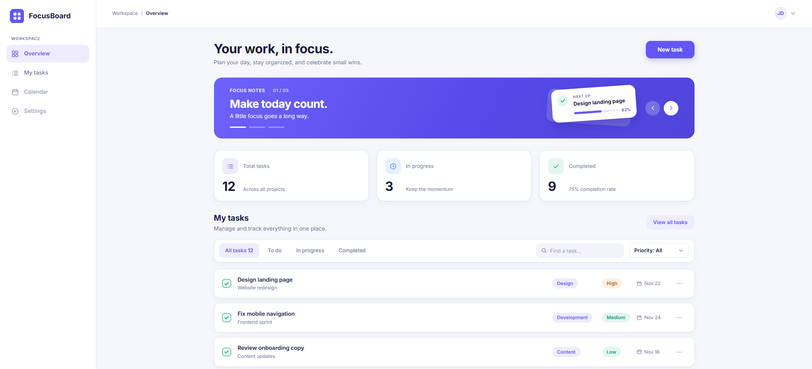
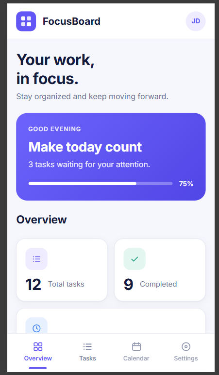

<<<<<<< HEAD
# FocusBoard

A responsive, single-user task dashboard built with React (Vite) and plain CSS, following the provided Figma frames (desktop 1440, mobile 390, "Create new task" form, and the three Focus notes carousel slides). Frontend only: no backend, auth, or database.

**Live URL:** https://focusboard-navy.vercel.app

## Setup

```bash
npm install
npm run dev      # local dev server
npm run build    # production build in dist/
npm run preview  # serve the production build locally
```

## Features

- Create, edit and delete tasks (delete asks for confirmation); status can be changed from the checkbox or the row's "..." menu
- Create/edit form with validation (title required, max 80 characters)
- Case-insensitive title search, status tabs (All / To do / In progress / Completed) and priority filter, all working together
- Stats (total, in progress, completed, completion %) derived from the task data, never hardcoded
- Focus notes carousel: all three Figma slides, previous/next buttons, dash indicators, arrow-key support
- Persistence in `localStorage`; the 12 sample tasks are only used when nothing has been saved yet
- Accessibility: semantic landmarks, labelled controls, visible focus rings, keyboard-operable menus and dialogs (focus trap, Esc to close, focus restored on close)
- Layouts: desktop (sidebar + top bar), tablet (header + bottom nav), mobile (hero card, 2-column stats, stacked task cards)

## State management choice

`useReducer` + React Context (`src/state/TaskContext.jsx`).

- **Single source of truth:** the `tasks` array lives in one reducer.
- **Predictable mutations:** four actions only (`ADD`, `UPDATE`, `DELETE`, `SET_STATUS`).
- **Synchronized UI:** stats and the filtered list are derived from `tasks` on every render, never stored separately.
- **Persistence:** one `useEffect` writes `tasks` to `localStorage` on every change; the initial state is read lazily from storage.
- Filters, open dialogs and the active nav item are local UI state in `App.jsx`.

Built-in hooks were chosen over Redux/Zustand because the state is small and shallow.

## Project structure

```
src/
  App.jsx                    layout, filters, dialog state
  state/TaskContext.jsx      reducer, provider, localStorage sync
  hooks/useModal.js          focus trap, Esc, scroll lock for dialogs
  utils/tasks.js             computeStats, filterTasks, date/greeting helpers
  data/sampleTasks.js        12 seed tasks, status/priority lists
  components/                Sidebar, TopBar, BottomNav, StatsCards, FocusCarousel,
                             HeroCard, Toolbar, TaskCard, TaskForm, ConfirmDialog, Icons
  styles.css                 all styles and breakpoints
```

## Design decisions

- The Figma form has no category field, so new tasks get the category "General"; existing tasks keep theirs when edited.
- The Figma tabs are All / In progress / Completed; a "To do" tab was added so every status can be filtered.
- Below 640px the carousel is replaced by the "Make today count" hero card, as in the mobile frame. The priority filter, which the mobile frame omits, is kept as a full-width select.
- Calendar and Settings navigation items are placeholders (marked "Coming soon").
- The carousel slide copy and the small preview card are static, as in the design.

## Known limitations

- Not yet visually compared pixel-by-pixel against Figma; spacing and colours were matched by eye from screenshots.
- Tasks are stored per browser; no cross-device sync.
- No automated tests.

## Screenshots
### Desktop View


### Mobile View


